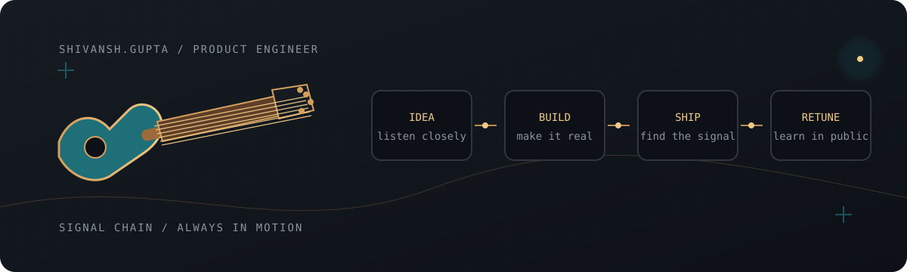

<div align="center">

# Shivansh Gupta

**Product engineer building useful things at the intersection of systems, AI, and good taste.**

[Portfolio](https://shivanshg.tech/) · [GitHub](https://github.com/sshivanshg) · Delhi, India



</div>

## The short version

I make products from the awkward middle: an interesting problem, an unfinished system, and a lot of sharp edges. I like taking that mess through architecture, interface, and launch until it feels obvious to the person using it.

When I am away from a terminal, I play electric guitar. The overlap is not accidental: rhythm, restraint, signal, feedback, and knowing when one more note makes the whole thing worse.

## Current setlist

| Product | What I am building |
| --- | --- |
| [Brixloop](https://brixloop.com) | An operating system for logistics teams: workflows, visibility, and the control layer behind real-world movement. |
| [Deskzy](https://deskzy.xyz) | A browser-first file toolkit. Most transformations happen locally, with an edge-native platform for the parts that need a backend. |
| [Vellum / MarketMind](https://vellum-ruby-sigma.vercel.app) | Cited, time-aware market research over filings, news, transcripts, and a user’s own documents. |
| [TinyTales](https://www.tinytalesvideos.com/) | A personalized children’s-story pipeline that turns an idea and a photo into illustrated books and narrated video. |
| [Khabro](https://github.com/sshivanshg/TAZAkhabar) | Local news, made legible: a universal Expo client paired with a .NET API and editorial workflow. |

## What I care about when shipping

```text
01  Start with the operational reality, not the feature list.
02  Make the complex path feel calm for the person on the other end.
03  Use AI where it improves the work; keep the guardrails explicit.
04  Treat the product, the infrastructure, and the interface as one instrument.
05  Ship, listen, retune, repeat.
```

## Signal chain

```text
product sense ──> TypeScript / React / Next.js ──> Cloudflare / Supabase
      │                         │
      └──> Python / Go / .NET ──┴──> AI systems, data workflows, and real users
```

I am especially interested in products with a hard backend and a human-facing surface: tools for teams, research systems with receipts, privacy-conscious utilities, and creative systems that make someone’s day more interesting.

<div align="center">

<sub>Good software has a groove: clear intent, clean execution, no wasted notes.</sub>

</div>
